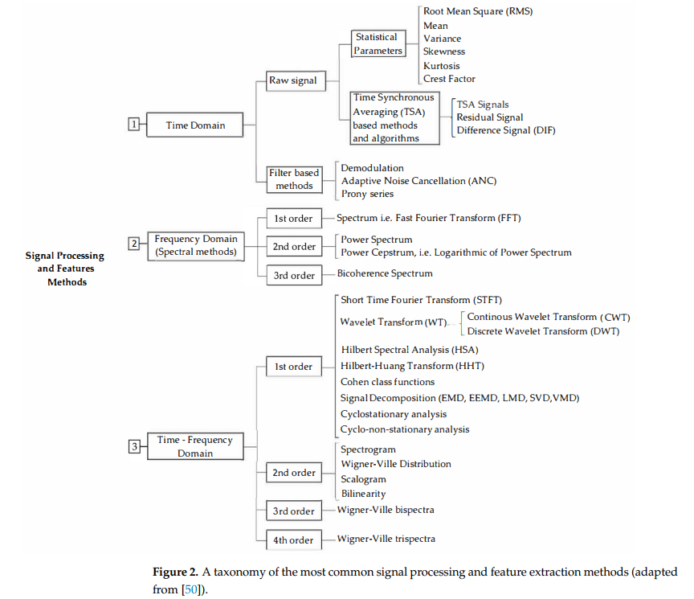
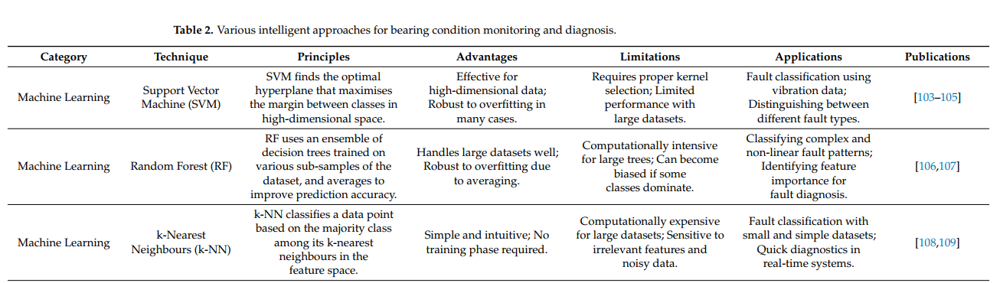

# Tractian DS Challenge — Condition Monitoring

## Setup

**Requirements:** Python ≥ 3.10, [uv](https://docs.astral.sh/uv/getting-started/installation/)

```bash
uv sync
```

## Data

Unzip the provided data files into the `data/` directory:

```bash
unzip part1.zip -d data/part1
unzip part2.zip -d data/part2
```

Expected structure after unzipping:

```
data/
  part1/
    data/{sample_id}.csv
    labels.csv
  part2/
    assets/{id}/fit.npz
    assets/{id}/predict.npz
    labels.csv
    test_data/{id}/fit.npz
    test_data/{id}/predict.npz
```

## Running

```bash
# Run Part 1 — Carpet Detector
uv run python main.py --part1

# Run Part 2 — Lubrication Model
uv run python main.py --part2

# Run both
uv run python main.py --part1 --part2
```

Outputs are saved to `outputs/part1/` and `outputs/part2/`.

## Submission

Submit your solution as a single GitHub repository containing:
- All code needed to reproduce your results.
- This README updated with any changes to setup or run instructions.
- Outputs generated by `main.py` (plots and reports).

## Approach

The solution is grounded in the review article:

> Kannan, V.; Zhang, T.; Li, H. *A Review of the Intelligent Condition Monitoring of Rolling Element Bearings*.
> Machines 2024, 12(7), 484. https://www.mdpi.com/2075-1702/12/7/484

### Features

The features were taken from the article's taxonomy of signal processing and feature extraction methods:



*Source: Kannan et al. (2024), Figure 2.*

### Models

The models were chosen from the machine learning approaches in the article's Table 2. A logistic regression was added
as a baseline:



*Source: Kannan et al. (2024), Table 2.*

### From the analysis to `main.py`

Each part was explored in a notebook before implementation: [`notebooks/eda_part1.ipynb`](notebooks/eda_part1.ipynb) and
[`notebooks/eda_part2.ipynb`](notebooks/eda_part2.ipynb). Each notebook compares the features and the models under
validation grouped by signal (Part 1) or by asset (Part 2).

The code run by `main.py` (`src/`) contains only the final decisions of those analyses, that is, the chosen model and
features of each part:

- **Part 1 (carpet detector):** k-NN (k = 25) on 6 band features (`level_db`, `flatness`, `env_peak_ratio`, `kurt`,
  `sk_mean`, `energy_cv`).
- **Part 2 (lubrication model):** RBF SVM with Platt calibration on 4 features (`rms`, `crest`, `kurt`, `skew`).

The models are trained on tables stored in `models/` (plain `.npz`, no pickle). To rebuild them from `data/`:

```bash
uv run python -m src.carpet_detector
uv run python -m src.lubrication_model
```
